# Banking_Credit_Card_Fraud_Detection_Using_LSTM

An end-to-end transaction-sequence fraud detection project using a TensorFlow/Keras LSTM, chronological holdout evaluation, and a Streamlit scoring interface.

## Business Problem and Banking Use Case

Fraud teams need to identify suspicious card activity while keeping legitimate transactions moving. This project scores the latest transaction in a ten-transaction window, reports a fraud probability and risk band, and demonstrates how an issuer could route high-risk transactions for blocking and OTP verification. It is a research/demo implementation, not a production authorization system.

## Dataset

The project uses the [Kaggle credit-card fraud dataset](https://www.kaggle.com/datasets/mlg-ulb/creditcardfraud), containing anonymized `V1`-`V28` PCA features, `Time`, `Amount`, and binary `Class` (0 genuine, 1 fraud). Download `creditcard.csv` into `data/` after accepting Kaggle's dataset terms, or configure the Kaggle API (`KAGGLE_USERNAME` and `KAGGLE_KEY`, or `~/.kaggle/kaggle.json`) for automatic download. The CSV is excluded from Git because it is large and subject to the dataset's terms.

Data checks write row/column statistics, missing-value counts, class counts, and fraud percentage to `data/dataset_summary.json`.

## Preprocessing and Model

Transactions are stably ordered by `Time`; `StandardScaler` is fit only on the first 80% of transactions. Rolling windows of ten transactions end at the transaction whose `Class` is predicted. The final chronological 20% is reserved for testing, while the last 10% of the training period is used for validation. The target transaction's feature row is included in its scoring window, as is customary for transaction authorization scoring.

```mermaid
flowchart LR
    A[Transaction features] --> B[Chronological 80/20 split]
    B --> C[Train-only StandardScaler]
    C --> D[Rolling windows of 10]
    D --> E[LSTM 64, sequences]
    E --> F[Dropout 0.3]
    F --> G[LSTM 32]
    G --> H[Dropout 0.2]
    H --> I[Dense 16 ReLU]
    I --> J[Dense 1 Sigmoid]
```



The network uses Adam, binary cross-entropy, and accuracy. Both balanced class weights and SMOTE (applied to flattened training windows only) are trained; their validation F1 and ROC-AUC select the final model and decision threshold. Early stopping and best-checkpoint restoration limit overfitting. The test set is held out from this comparison.

## Training and Evaluation

Use Python 3.12. From this directory:

```bash
python -m venv .venv
source .venv/bin/activate
python -m pip install -r requirements.txt
python -m src.data_loader
python -m src.train
python -m src.evaluate
python -m src.predict
```

The training run uses a fixed seed, ten maximum epochs, and batches of 32. It writes accuracy, precision, recall, F1, ROC-AUC, threshold, class report, confusion matrix, ROC curve, loss curve, accuracy curve, scaler, model metadata, and strategy comparison under `models/`. Reported classification metrics use the validation-selected threshold; ROC-AUC uses probabilities.

| Metric | Result |
| --- | --- |
| Training sequences | 227,836 |
| Test sequences | 56,962 (75 fraud) |
| Accuracy | 99.9561% |
| Precision | 93.1034% |
| Recall | 72.0000% |
| F1 score | 81.2030% |
| ROC-AUC | 96.4478% |

These results are from the chronological holdout in the Kaggle run completed for this project. The selected class-weight candidate scored validation F1 0.8444 (ROC-AUC 0.9353); the SMOTE candidate scored validation F1 0.8095 (ROC-AUC 0.9552). The decision threshold (0.7643) is selected using the training-period validation window, not the test labels. Metrics are a reproducible baseline, not a guarantee of production performance.

## Prediction and Streamlit

The CLI scores the final ten real transactions by default. To provide ten transaction amounts (the PCA features are zero-filled for this simplified demo input):

```bash
python -m src.predict --amounts 24.5,31,19.99,54,42,18.5,25,39,47,125
streamlit run app.py
```

The app accepts a customer ID, current amount, and nine prior amounts, displays probability, a progress/gauge-style indicator, a probability chart, risk alerts, and a recommendation. Risk bands are LOW below 40%, MEDIUM from 40% to below 70%, and HIGH from 70% upward. The app requires a trained model and scaler.

## Artifacts and Screenshots

- Model: `models/fraud_lstm_model.h5`
- Metrics: `models/evaluation_metrics.json`
- Classification report: `models/classification_report.txt`
- Confusion matrix: `models/confusion_matrix.png`
- Curves: `models/plots/roc_curve.png`, `models/plots/loss_curve.png`, `models/plots/accuracy_curve.png`

Screenshots: add the Streamlit assessment view and evaluation plots here after running the project.

Sample CLI smoke test against the latest ten real transactions returned fraud probability `0.0028%`, risk `LOW`, and the routine-monitoring recommendation. The Streamlit server was started and its `/_stcore/health` endpoint returned `ok` at `http://localhost:8501`.

## Deployment

Install `requirements.txt`, provide the dataset and Kaggle credentials if needed, train the model, then run `streamlit run app.py`. For hosted Streamlit, configure Kaggle credentials as deployment secrets or include the already-trained model and scaler in the deployment artifact store; do not commit credentials or the dataset. `runtime.txt` targets Python 3.12.9.

## Future Improvements

Use complete transaction feature vectors in the application rather than amount-only examples; tune operating thresholds against business costs; validate on newer time periods and across customers; add drift monitoring, explainability, authentication, audit logs, and a secure online feature store before any production deployment.